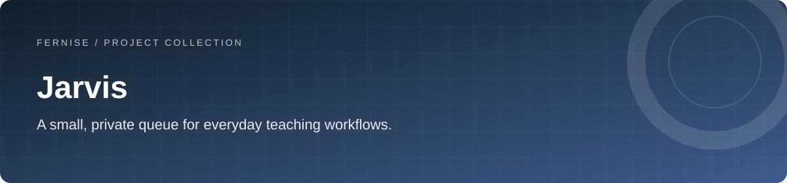
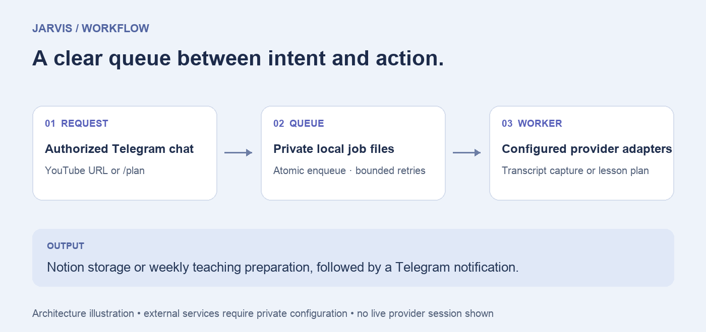

# Jarvis

A small, private queue for everyday teaching workflows.

[](https://github.com/Fernise/jarvis/actions/workflows/ci.yml)
[](LICENSE)
[](#development-approach)

A Telegram-triggered Python assistant for queued YouTube transcript capture, Notion storage and AI-assisted weekly teaching preparation.

**Technology:** Python · Telegram · Notion · OpenAI · Supadata

[Overview](#what-it-does) · [Quick start](#quick-start) · [Architecture](docs/ARCHITECTURE.md) · [Verification](docs/VERIFICATION.md)

## What it does

For teachers experimenting with a small personal assistant for transcript capture and weekly preparation.

- A single authorized Telegram chat and explicit supported command types.
- Private file-backed queue state with bounded retries.
- YouTube transcript capture and Notion storage.
- Weekly speaking-theme preparation from a teacher’s Notion catalog.

## Workflow



A source-level workflow illustration. Provider access is configured separately; this image does not represent a live execution.

## Project status

A packaged prototype. Offline tests cover queue and authorization behavior; external provider workflows still require configuration and a separate end-to-end rehearsal. Run one worker per queue. Jobs interrupted in processing need manual inspection, and external side effects are not exactly-once.

## Quick start

Requires Python 3.11+.

```sh
git clone https://github.com/Fernise/jarvis.git
cd jarvis
python3 -m venv .venv
. .venv/bin/activate
python -m pip install -r requirements.txt -e .
cp .env.example .env
```

Set `TELEGRAM_BOT_TOKEN` and the single `TELEGRAM_ALLOWED_CHAT_ID` privately. Configure Notion and Supadata for transcript jobs, and Notion plus OpenAI for planning jobs. See [configuration and required Notion fields](docs/CONFIGURATION.md).

Run these in separate terminals with the virtual environment active:

```sh
jarvis-bot
jarvis-worker
```

Send a YouTube URL or `/plan Demo Learner` from the authorized chat. The bot and worker create their private runtime directories automatically. No personal chat IDs, student profiles, transcripts, tokens or historical jobs are included.

## Verification

```sh
python -m unittest discover -s tests -v
```

Tests run offline and use temporary queues. They cover unauthorized chats, URL boundaries, private file permissions, retry limits, malformed jobs and notification failure after task completion. They never message Telegram or write to Notion.

## Repository map

| Path | Responsibility |
| --- | --- |
| `src/jarvis/` | Packaged bot, worker, queue and provider adapters |
| `tests/` | Offline queue and authorization tests |
| `pyproject.toml` | Package metadata and installed CLI entry points |
| `requirements.txt` | Dependency snapshot for reproducible setup |
| `.env.example` | Blank integration settings |
| `docs/` | Architecture, configuration and prototype limitations |

## Documentation

- [Verification record and limits](docs/VERIFICATION.md)
- [Architecture and data boundaries](docs/ARCHITECTURE.md)
- [Configuration](docs/CONFIGURATION.md)
- [Security policy](SECURITY.md)
- [Contribution guidance](CONTRIBUTING.md)
- [Third-party notices](THIRD_PARTY_NOTICES.md)

## Development approach

Created and directed by **[Fernando · @Fernise](https://github.com/Fernise)** using agentic programming with **OpenAI Codex**. Product direction, requirements and final decisions are the author’s; coding agents contributed to implementation, refactoring, documentation and testing.

See the [verification record](docs/VERIFICATION.md) for completed checks and known limitations.

## License

Original project code is licensed under the [MIT License](LICENSE).

Third-party libraries and assets retain their own licenses.
